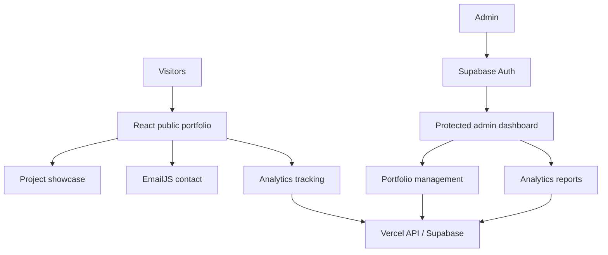

<div align="center">

# Web Portfolio
**A modern developer portfolio with an integrated content manager and analytics dashboard.**

[](https://react.dev/)
[](https://vite.dev/)
[](https://supabase.com/)
[](https://gsap.com/)

[Live Website](https://www.kktp.my/) · [Source Code](https://github.com/kktpx/Web-Portfolio)

</div>

## Overview

A responsive, component-based **personal developer portfolio** built with React and Vite. Beyond presenting projects and skills, it includes a **Supabase-backed admin area** for managing showcased work and an **analytics dashboard** for understanding how visitors use the site.

## Features

### Public Website

- Responsive hero, about, skills, projects, GitHub activity, and contact sections.
- Animated UI interactions using GSAP and reusable React components.
- Project showcase with source-code and demo links.
- Contact form connected to EmailJS.
- Downloadable resumes and links to developer profiles.

### Admin & Analytics

- Authenticated admin routes protected with Supabase Auth.
- Create, edit, publish/unpublish, and delete portfolio projects.
- Project image uploads using Supabase Storage.
- Visitor event tracking and dashboard visualizations, including project interactions and navigation behavior.
- Analytics-related views for activity, journeys, traffic sources, and goals.

## Tech Stack

| Area | Technologies |
| --- | --- |
| Frontend | React 19, JavaScript / JSX, Vite 7, CSS |
| UI / Motion | GSAP, Lucide React, custom components |
| Charts | Recharts, React GitHub Calendar |
| Backend Services | Supabase Auth, PostgreSQL, Storage |
| Analytics | Custom tracking services and Vercel API handlers |
| Contact | EmailJS |
| Quality | ESLint, Node-based utility tests |

## Architecture



## Getting Started

**Requirements:** Node.js supported by Vite 7, npm, Git, and optional accounts for Supabase/EmailJS integrations.

```bash
git clone https://github.com/kktpx/Web-Portfolio.git
cd Web-Portfolio
npm install
```

Copy `.env.example` to `.env` and set the required public integration credentials:

```env
VITE_EMAILJS_SERVICE_ID=your_service_id
VITE_EMAILJS_TEMPLATE_ID=your_template_id
VITE_EMAILJS_PUBLIC_KEY=your_public_key
VITE_SUPABASE_URL=https://your-project.supabase.co
VITE_SUPABASE_PUBLISHABLE_KEY=your_publishable_key
```

To enable the admin/CMS features, initialize a development Supabase project using `supabase/setup.sql` and `supabase/storage-policies.sql`, then configure the `portfolio-images` bucket and an authorized admin user. Analytics SQL scripts are under `supabase/`; review and apply the appropriate schema version for your environment.

Start the site:

```bash
npm run dev
```

### Other Commands

```bash
npm run lint       # ESLint
npm run build      # Production bundle
npm run preview    # Preview dist/ locally
```

## App Routes

| Route | Description |
| --- | --- |
| `/` | Public portfolio |
| `/admin/login` | Admin sign-in |
| `/admin` | Analytics overview |
| `/admin/projects` | Portfolio project management |
| `/admin/profile` | Placeholder page |
| `/admin/contact` | Placeholder page |
| `/admin/resume` | Placeholder page |

## Project Structure

```text
Web-Portfolio/
├── src/
│   ├── components/           # Public sections and admin UI
│   ├── pages/                # Public and admin pages
│   ├── services/             # Portfolio and analytics services
│   ├── hooks/                # Auth, heartbeat, section tracking
│   ├── data/                 # Project data
│   └── lib/                  # Supabase client
├── api/                      # Serverless analytics endpoint
├── supabase/                 # Database and security scripts
├── tests/                    # Utility and handler tests
└── public/                   # Images, favicon, resumes
```

## Deployment & Security

The frontend builds to `dist/` and can be deployed to Vercel. Configure the required environment variables and serverless functions in your deployment environment.

- Enable appropriate Supabase Row Level Security for admin-managed data.
- Do not place a service-role key or other server secrets in `VITE_*` variables; these are included in browser builds.
- Check analytics retention, privacy disclosures, and consent requirements before collecting production traffic data.

## License

See [LICENSE](LICENSE) for project usage terms.

---

<div align="center">Created by <a href="https://github.com/kktpx">kktpx</a>.</div>
